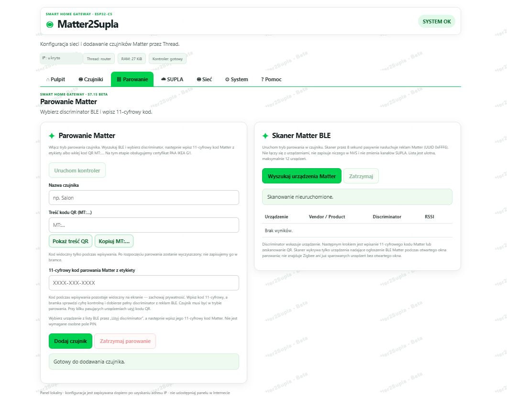
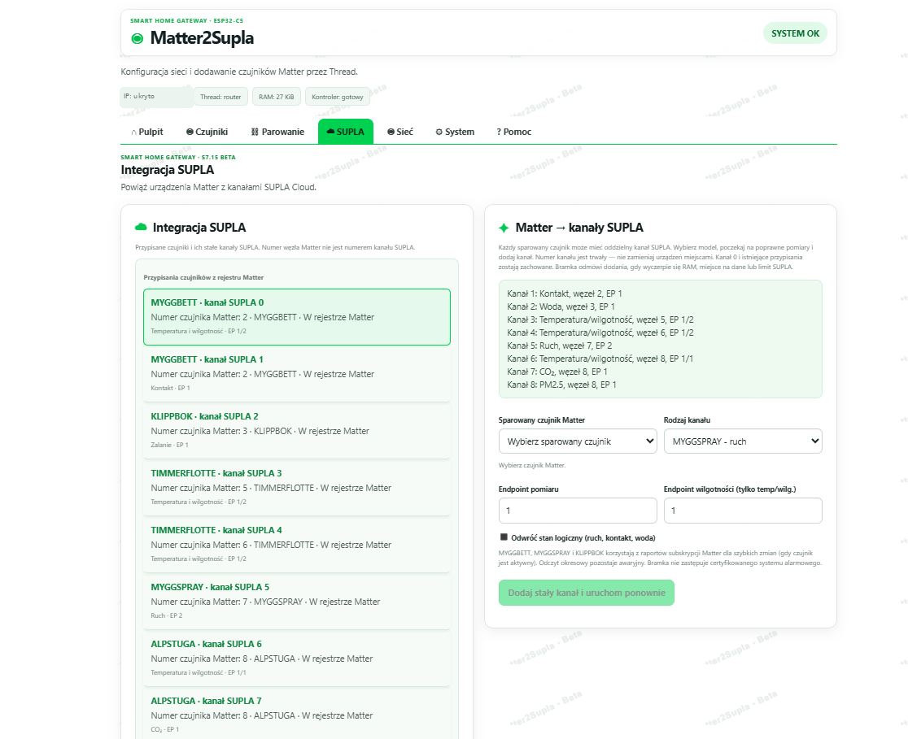
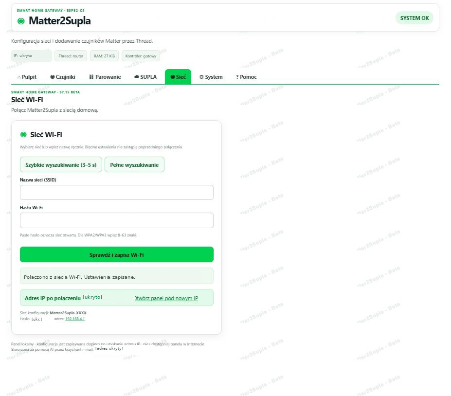
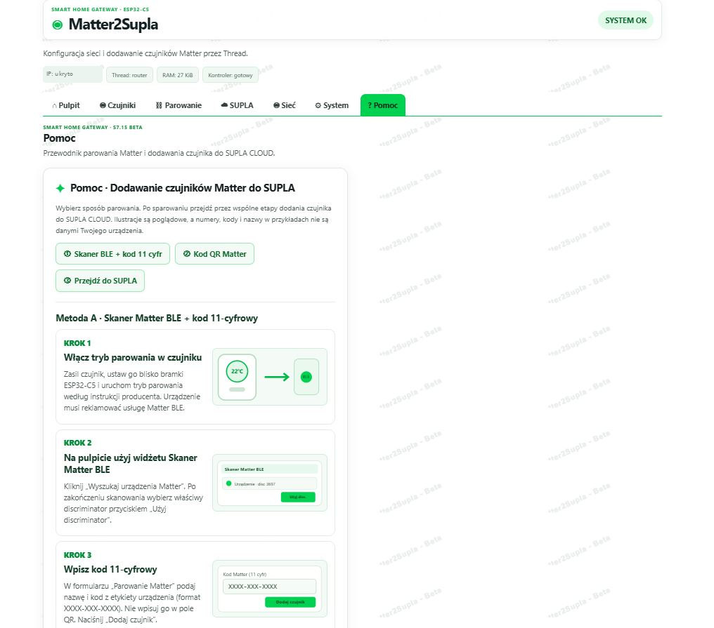

## Galeria panelu WWW

| Parowanie urządzeń Matter | Integracja SUPLA |
| :---: | :---: |
|  |  |

| Konfiguracja Wi-Fi | Centrum pomocy |
| :---: | :---: |
|  |  |

*Zrzuty poglądowe wcześniejszej wersji interfejsu Matter2Supla.*
