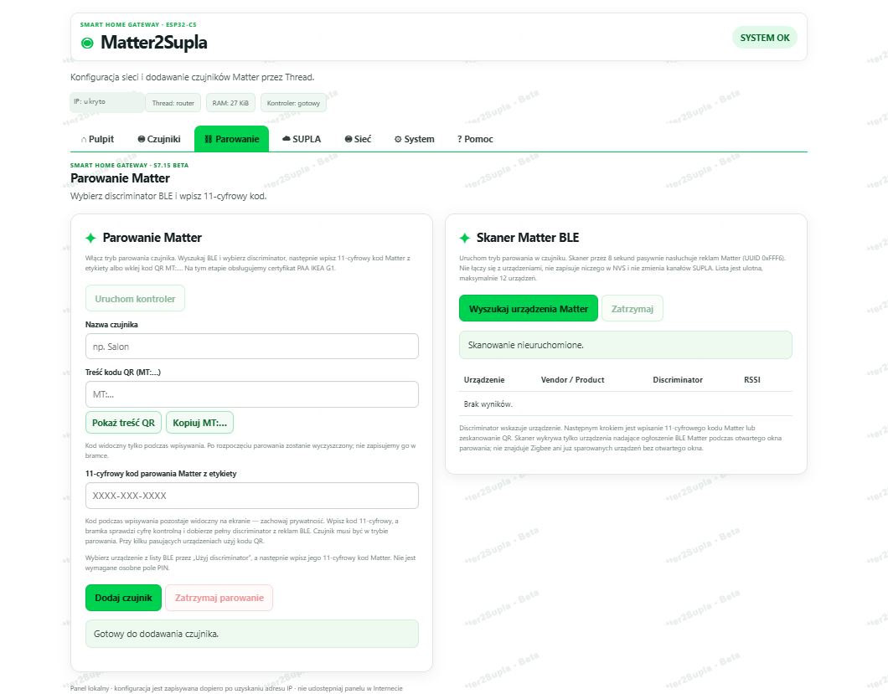
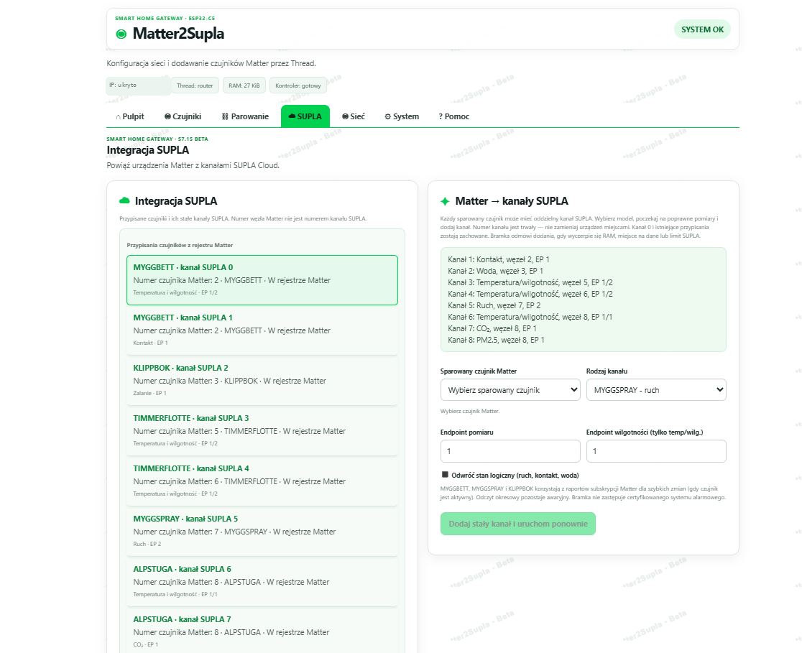
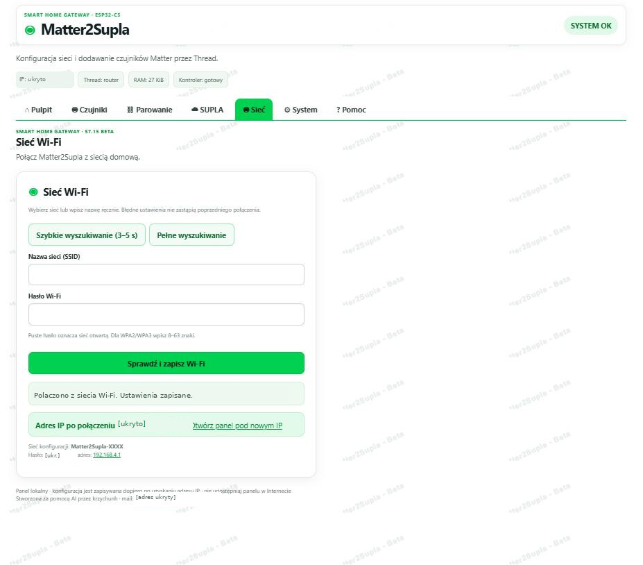
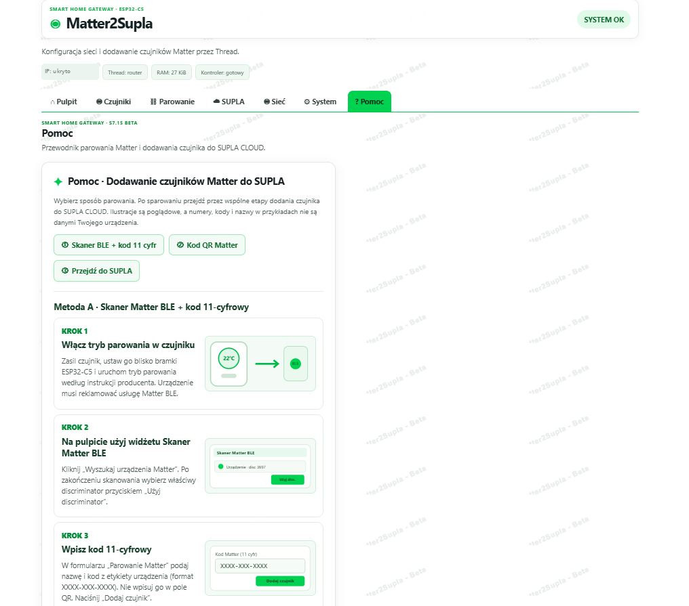

# Matter2Supla — S7.18 RC4.7D.5 BETA

**ULTRA FAST ONLINE | Bramka Matter over Thread → SUPLA oparta na ESP32-C5**  
**Wydanie:** 25 listopada 2026 r. — Beta

  

Matter2Supla pozwala połączyć kompatybilne czujniki Matter over Thread z systemem SUPLA bez dodatkowego serwera Home Assistant. Bramka odbiera pomiary i stany czujników przez Thread i przekazuje je do SUPLA Cloud za pośrednictwem Wi-Fi.

> Niezależny projekt hobbystyczny, nieoficjalny produkt IKEA, SUPLA ani Espressif. Wydanie RC4.7D.5 jest eksperymentalne; wydajność i stabilność nowych mechanizmów odzyskiwania wymagają testów sprzętowych.

## Pobierz firmware

| Moduł | Flash / PSRAM | Aktualizacja APP (0x20000) | Pełna instalacja (0x0) |
| --- | --- | --- | --- |
| ESP32-C5 N16R8 | 16 MB / 8 MB | [APP.bin](https://github.com/krzychunh/Matter2Supla-Releases/releases/download/v0.9.3-s7.18-rc4.7d.5-beta/Matter2Supla-S7.18-RC4.7D.5-BETA-N16R8-APP.bin) | [FULL-0x0.bin](https://github.com/krzychunh/Matter2Supla-Releases/releases/download/v0.9.3-s7.18-rc4.7d.5-beta/Matter2Supla-S7.18-RC4.7D.5-BETA-N16R8-FULL-0x0.bin) |
| ESP32-C5 N32R8 | 32 MB / 8 MB | [APP.bin](https://github.com/krzychunh/Matter2Supla-Releases/releases/download/v0.9.3-s7.18-rc4.7d.5-beta/Matter2Supla-S7.18-RC4.7D.5-BETA-N32R8-APP.bin) | [FULL-0x0.bin](https://github.com/krzychunh/Matter2Supla-Releases/releases/download/v0.9.3-s7.18-rc4.7d.5-beta/Matter2Supla-S7.18-RC4.7D.5-BETA-N32R8-FULL-0x0.bin) |

[Wydanie RC4.7D.5](https://github.com/krzychunh/Matter2Supla-Releases/releases/tag/v0.9.3-s7.18-rc4.7d.5-beta) · [SHA256](https://github.com/krzychunh/Matter2Supla-Releases/releases/download/v0.9.3-s7.18-rc4.7d.5-beta/Matter2Supla-RC47D5-SHA256SUMS.txt) · [Instrukcja instalacji](INSTALL.md)

## Najważniejsze zmiany w RC4.7D.5

- Adaptacyjne odzyskiwanie dostępności czujników: do dwóch równoległych odczytów, gdy pozwala na to pamięć.
- Priorytetyzacja urządzeń na podstawie SRP i wykorzystanie zapisanych profili NVS.
- Skrócone odstępy odczytów w fazie rozruchu, bez zmiany odstępów ponawiania prób dla niedostępnych urządzeń.
- Szybsze uruchamianie Wi-Fi, Thread i połączenia z SUPLA; grupowanie rejestracji nowych kanałów.
- Zachowanie numeracji istniejących kanałów i sprawdzanie rzeczywistych raportów urządzeń.
- BLE na żądanie, alokacje CHIP, Matter i mDNS w PSRAM oraz zabezpieczenia RAM/DMA.
- Nowy przycisk zatrzymywania i wznawiania nowych odczytów w panelu parowania. Trwające operacje mogą się zakończyć, a istniejące subskrypcje mogą nadal dostarczać raporty.
- Konfiguracje N16R8 i N32R8; limit 32 bezpośrednich dzieci Thread nie oznacza gwarancji obsługi 32 czujników przez aplikację.

## Obsługiwane profile urządzeń

| Model IKEA | Profil |
| --- | --- |
| TIMMERFLOTTE | Temperatura i wilgotność |
| MYGGSPRAY | Ruch |
| MYGGBETT | Otwarcie drzwi i okien |
| KLIPPBOK | Zalanie |
| ALPSTUGA | Jakość powietrza |

Zakres dostępnych pomiarów i stopień przetestowania zależą od modelu.

## Panel WWW — galeria zrzutów

Poniżej znajdują się **rzeczywiste zrzuty interfejsu Matter2Supla** udostępnione przez autora projektu. Przed publikacją ukryto lokalny adres IP i wybrane dane konfiguracyjne. Kliknij obraz, aby obejrzeć go w pełnym rozmiarze.

| Parowanie urządzeń Matter | Integracja Matter → SUPLA |
| :---: | :---: |
| [](screenshots/pairing-s717.jpg) | [](screenshots/supla-s717.jpg) |

| Konfiguracja sieci Wi-Fi | Pomoc i instrukcja parowania |
| :---: | :---: |
| [](screenshots/wifi-s717.jpg) | [](screenshots/help-s717.jpg) |

> **Uwaga o oznaczeniu wersji:** zdjęcia przedstawiają wcześniejszy interfejs z historyczną etykietą S7.15 BETA. Nie są zrzutami RC4.7D.5; aktualny panel może się różnić. Na zdjęciach ukryto wybrane dane konfiguracyjne. Galeria nie obejmuje osobnych zrzutów zakładek Pulpit ani Czujniki.

## Co potrafi bramka?

- Łączy się z domowym Wi-Fi i udostępnia lokalny panel WWW.
- Działa jako kontroler Matter i obsługuje komunikację Thread z czujnikiem.
- Paruje czujnik przy użyciu tekstowej zawartości kodu QR `MT:…` albo poprawnego PIN-u Matter i pełnego discriminator.
- Odbiera **automatyczne raporty temperatury i wilgotności** przez subskrypcję Matter; ma też konfigurowalny odczyt zapasowy.
- Przekazuje temperaturę, wilgotność i stany obsługiwanych czujników do SUPLA Cloud.
- Automatycznie przygotowuje obsługiwane kanały SUPLA i zachowuje ich przypisania.
- Pozwala zatrzymać i wznowić nowe odczyty czujników z panelu WWW.
- Pokazuje baterię czujnika (jeśli udało się odebrać pomiar).
- Udostępnia **Smart Dashboard** z ikonami Wi-Fi, Thread, Matter i SUPLA: zielone oznaczają stan aktywny, szare — nieaktywny.
- Pokazuje RSSI i jakość łącza Thread (0–3), gdy czujnik jest bezpośrednim dzieckiem bramki i można przypisać pomiar.
- Wyświetla prosty wykres temperatury zbierany podczas otwartej strony WWW.
- Oferuje skaner ogłoszeń **Matter BLE** oraz podgląd i kopiowanie tekstu QR w formularzu parowania.

**Uwaga:** historia wykresu istnieje tylko w pamięci otwartej przeglądarki. Kod `MT:…` nie jest przechowywany jako historia QR i nie można go odzyskać po wcześniejszym parowaniu.

## Jak to działa?

```text
IKEA TIMMERFLOTTE
     │ Matter over Thread (IEEE 802.15.4)
     ▼
ESP32-C5 — Matter2Supla
     │ Wi-Fi / Internet
     ▼
SUPLA Cloud
     │
     ▼
Aplikacja SUPLA / przeglądarka
```

## Wymagania

- Płytka **ESP32-C5 N16R8 lub N32R8** z wgranym Matter2Supla (odpowiednio 16 lub 32 MB flash, 8 MB PSRAM).
- Stabilne zasilanie bramki.
- Domowa sieć Wi-Fi 2,4 GHz z dostępem do Internetu.
- Czujnik **IKEA TIMMERFLOTTE** z bateriami oraz jego kod QR Matter.
- Konto w [SUPLA Cloud](https://cloud.supla.org).
- Telefon albo komputer z przeglądarką WWW.

## Pierwsze uruchomienie — Wi-Fi

1. Włącz zasilanie bramki ESP32-C5.
2. Jeśli Wi-Fi nie jest jeszcze skonfigurowane, połącz telefon lub komputer z siecią **`Matter2Supla-XXXX`**.
3. Domyślne hasło tej sieci konfiguracyjnej to **`12345678`**.
4. Otwórz adres **http://192.168.4.1**.
5. W sekcji **„Sieć Wi-Fi”** kliknij **„Wyszukaj sieci”** albo ręcznie wpisz SSID.
6. Wpisz hasło domowej sieci i wybierz **„Sprawdź i zapisz Wi-Fi”**.
7. Po połączeniu bramka otrzyma adres IP z routera. Połącz się ponownie z domowym Wi-Fi i otwórz ten adres w przeglądarce.

> Adres `192.168.4.1` dotyczy trybu konfiguracyjnego, nie docelowego adresu w domowej sieci. Docelowe IP można sprawdzić w routerze. Nie wystawiaj panelu konfiguracyjnego bezpośrednio do Internetu.

## Dodawanie IKEA TIMMERFLOTTE

1. Włóż baterie do TIMMERFLOTTE i uruchom **tryb parowania Matter** zgodnie z instrukcją czujnika. W razie potrzeby ponownie otwórz okno parowania przyciskiem systemowym.
2. W panelu Matter2Supla sprawdź stan kontrolera Matter. Jeśli jest wyłączony, użyj **„Uruchom kontroler”** i poczekaj na gotowość Thread/Matter.
3. W sekcji **„Dodaj czujnik IKEA Matter”** wpisz nazwę, np. `TIMMERFLOTTE Salon`.
4. Odczytaj **tekstową zawartość** kodu QR Matter (zaczyna się od **`MT:`**) i wklej ją w pole **„Treść kodu QR (MT:…)”**.
5. Możesz użyć **„Pokaż treść QR”** do sprawdzenia wpisu lub **„Kopiuj MT:…”**. Kod traktuj jako poufne dane parowania.
6. Kliknij **„Dodaj czujnik”**. Nie restartuj bramki podczas parowania.
7. Po udanym parowaniu sprawdź listę czujników i poczekaj na pierwsze pomiary.

Alternatywnie formularz pozwala wpisać **PIN Matter i pełny discriminator (0–4095)**. Sam discriminator wykryty przez skaner BLE nie wystarcza do parowania. Najprościej użyć pełnego `MT:…`.

**Skaner Matter BLE** pokazuje urządzenia, które aktualnie ogłaszają możliwość parowania. Samo wykrycie w skanerze nie oznacza jeszcze dodania czujnika.

## Połączenie z SUPLA

1. Zaloguj się do [SUPLA Cloud](https://cloud.supla.org) i sprawdź adres serwera swojego konta.
2. Włącz rejestrację nowych urządzeń na czas pierwszego podłączania bramki.
3. W panelu Matter2Supla otwórz sekcję SUPLA i włącz integrację.
4. Wprowadź host serwera SUPLA (bez https:// i portu) oraz e-mail konta SUPLA. Nie wpisuj hasła konta SUPLA.
5. Zapisz konfigurację i sprawdź status połączenia. W zależności od stanu konfiguracji bramka może wymagać restartu.
6. Sprawdź automatycznie przygotowane kanały i poczekaj na rzeczywiste raporty czujników. Dla TIMMERFLOTTE dotychczas używane endpointy to 1 (temperatura) i 2 (wilgotność); dla innych urządzeń zależą od profilu.

> Zachowanie przypisań kanałów jest ważne dla ciągłości historii pomiarów. Nie usuwaj ani nie zmieniaj ich przypadkowo.

## Smart Dashboard

Na górze panelu znajdują się cztery ikony: **Wi-Fi**, **Thread**, **Matter**, **SUPLA**. Kolor **zielony** oznacza aktywny stan danej usługi, a **szary** — brak aktywności lub połączenia.

Karta czujnika pokazuje **temperaturę, wilgotność, baterię, ostatni raport Matter i subskrypcję**. Poniżej jest wskaźnik **siły sygnału Thread** z RSSI w dBm oraz jakością 0–3.

**Ograniczenie RSSI:** OpenThread udostępnia dane bezpośrednio podłączonych dzieci Thread. Jeżeli czujnik komunikuje się przez inny router lub nie można go jednoznacznie zidentyfikować, panel nie powinien przypisywać obcego RSSI do TIMMERFLOTTE. Czujnik bateryjny może spać, więc ostatni odczyt RSSI nie musi być bieżący.

Na dole dostępne są ustawienia, lista urządzeń, skaner BLE oraz diagnostyka. Podgląd `/api/status` służy do rozwiązywania problemów; przed udostępnieniem jego zawartości usuń prywatne informacje.

## Instalacja i aktualizacja firmware

Pobierz właściwy obraz dla swojego modułu z [publicznego wydania](https://github.com/krzychunh/Matter2Supla-Releases/releases/tag/v0.9.3-s7.18-rc4.7d.5-beta). Szczegółowe komendy dla N16R8 i N32R8 znajdują się w [instrukcji instalacji](INSTALL.md).

| Obraz | Adres zapisu | Zastosowanie |
| --- | --- | --- |
| APP.bin | 0x20000 | Aktualizacja zgodnej istniejącej instalacji |
| FULL-0x0.bin | 0x0 | Czysta instalacja |

**Uwaga:** FULL nadpisuje obszar NVS, usuwając konfigurację Wi-Fi, SUPLA, Thread i parowania Matter. APP przy zgodnym układzie partycji zachowuje konfigurację. Nie używaj erase-flash do zwykłej aktualizacji. Przed zapisem sprawdź model płytki, port szeregowy i SHA256. Tryb flash DIO, 80 MHz.

Obraz pełny zawiera bootloader (0x2000), tablicę partycji (0x8000) i aplikację (0x20000).

## Rozwiązywanie problemów

| Problem | Co sprawdzić |
| --- | --- |
| Nie otwiera się panel | Czy urządzenie ma adres IP w routerze; przy pierwszym uruchomieniu użyj `192.168.4.1` po połączeniu z AP bramki |
| Czujnik nie jest wykrywany | Tryb parowania, baterie, odległość od bramki, skaner BLE Matter |
| Nie udaje się parowanie | Poprawność `MT:…`, gotowość Thread/Matter, czy czujnik nie jest już powiązany z innym kontrolerem |
| Brak baterii | Poczekaj na udany odczyt; przy braku odpowiedzi bramka ponawia próbę |
| Brak sygnału Thread | Czujnik może być za innym routerem Thread lub przypisanie RSSI może być niejednoznaczne |
| SUPLA offline | Poprawność hosta, e-maila, aktywna rejestracja urządzeń i dostęp do Internetu |
| Jest pomiar Matter, ale nie w SUPLA | Numer węzła i endpointy, stan połączenia SUPLA, rejestracja urządzenia |

## Bezpieczeństwo i prywatność

- **Nie publikuj** swojego kodu Matter `MT:…`, haseł Wi-Fi, tokenów ani zrzutów pamięci NVS.
- Domyślna sieć konfiguracyjna ma znane hasło `12345678`; uruchamiaj konfigurację w zaufanym otoczeniu.
- Nie udostępniaj lokalnego panelu WWW bezpośrednio przez przekierowanie portów z Internetu.
- Przed publicznym `git push` sprawdzaj zmiany i pliki konfiguracyjne, również te wyłączone z kompilacji.
- Projekt jest w fazie Beta; nie stosuj go jako jedynego źródła danych w systemach wymagających niezawodności lub bezpieczeństwa.

## Stan projektu i plany

Obie wersje APP i FULL RC4.7D.5 zostały przygotowane i opublikowane z sumami SHA256. Wcześniejsze wydanie S7.17 HTTP PSRAM FIX1 przeszło pięciominutowy test panelu WWW bez nowych błędów alokacji; nie jest to wynik testu RC4.7D.5.

Kolejne etapy obejmują pomiary czasu odzyskiwania czujników, długotrwałe testy pamięci i równoległych odczytów oraz dalsze rozszerzanie obsługi urządzeń Matter.

## Licencje i autorstwo

Projekt: **[krzychunh](https://github.com/krzychunh)**. To repozytorium służy do dystrybucji firmware i dokumentacji, nie zawiera kodu źródłowego projektu. Komponenty zewnętrzne podlegają swoim licencjom; niniejszy opis nie zmienia praw wynikających z tych licencji.

---

**Matter2Supla — Matter i Thread w świecie SUPLA.**
